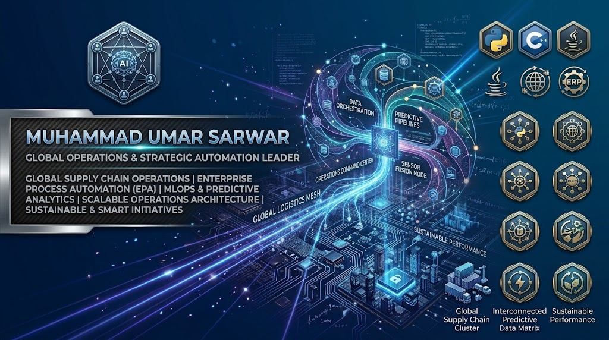

  

  
  
  

  

---

### 👋 Hi, I'm Muhammad Umar Sarwar
- **Current Role:** Floor Manager & AI Operations Specialist | Frontend & Full Stack Developer
- **Focus:** Building intelligent, modern & responsive web experiences & automated systems • Python • JavaScript
- **Portfolio:** [muhammadumarsarwar30.netlify.app](https://muhammadumarsarwar30.netlify.app/)
- **LinkedIn:** [Umar Sarwar](https://www.linkedin.com/in/umar-sarwar-2a7a19426/)
- **Email:** [umardogar3001@gmail.com](mailto:umardogar3001@gmail.com)

---

### 📊 Projects & Systems

| Project | Tech Stack | Link |
| :--- | :--- | :--- |
| **Bank Management System** — Accounts, deposits & transactions logic | Python, OOP | [Repo](https://github.com/umar-sarwar-dev/bank-management-) |
| **Space Dodger** — Arcade game logic | Python, JavaScript | [Repo](https://github.com/umar-sarwar-dev/space-dodger) |
| **Sada Adda** — Chai & qehwa cafe landing page | HTML, CSS, JavaScript | [Repo](https://github.com/umar-sarwar-dev/sada-adda) |
