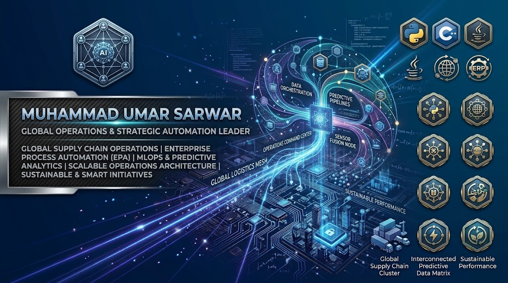

  

  
  
  

---

### 👋 Hi, I'm Muhammad Umar Sarwar
- **Current Role:** Floor Manager & Operations Specialist
- **Focus Areas:** Business Process Automation, Data Modeling, Workflow Optimization, and Team Management.
- Yeh repository mere custom scripts, operational tools, aur business automation frameworks ka public portfolio hai.

---

### 📊 Operations & Business Automation Systems

| Project & Description | Tech Stack | Repository |
| :--- | :--- | :--- |
| **Floor & Inventory Tracking System** - Automated solution designed for day-to-day warehouse/floor operations, tracking stock movement and live status. | Python, SQL, Excel Dashboards | [View Code](https://github.com/umar-sarwar-dev) |
| **Bank Management System** - Secure backend logic handling user accounts, deposits, statements, and transaction processing. | Python, OOP | [View Code](https://github.com/umar-sarwar-dev/bank-management-) |
| **Retail & Staff Management Hub** - Centralized management utility controlling attendance, shift coordination, and employee productivity reports. | PHP, JavaScript, MySQL | [View Code](https://github.com/umar-sarwar-dev) |

---

### ⚡ Mini Scripts & Utility Tools

| Project & Description | Tech Stack | Repository |
| :--- | :--- | :--- |
| **Space Dodger Arcade Game** - Interactive console and browser-based arcade logic built with clean algorithms and loops. | Python, JavaScript | [View Code](https://github.com/umar-sarwar-dev/space-dodger) |
| **Data Analysis & Statistics Toolkit** - Custom scripts handling linear regression, scatter plots, and confidence interval calculations. | Python, Pandas, NumPy | [View Code](https://github.com/umar-sarwar-dev) |

---

### 💻 Skills & Tech Stack

- **Languages & Scripting:** Python, JavaScript, HTML/CSS, SQL, PHP
- **Data & Analytics:** Business Statistics, Quantitative Modeling, Excel Dashboards, Data Interpretation
- **Management & Workflow:** Floor Management, Process Optimization, Team Coordination, Operations Strategy
- **Tools & Environments:** Git, GitHub, VS Code, Windows Administration

---

### 📬 Connect With Me

- **Location:** Lahore, Punjab, Pakistan
- **Email:** your-email@example.com
- **LinkedIn:** [linkedin.com/in/your-profile](#)

---

  

